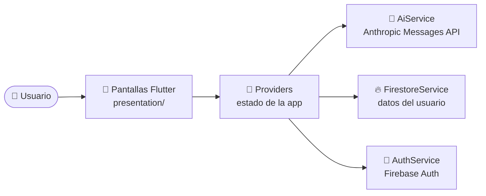

<div align="center">

# 💪 FitCoach

**Tu entrenador personal con IA: planes de entrenamiento y nutrición a tu medida, seguimiento de progreso y un chat para resolver dudas.**


</div>

---

## ✨ ¿Qué es FitCoach?

FitCoach es una app multiplataforma hecha con **Flutter**. Tras un onboarding donde cuentas tu objetivo y tu nivel, usa la **API de Claude** para generar un plan de entrenamiento y un plan de comidas personalizados, y te acompaña con un chat de asesoramiento y un registro diario de tu progreso.

## 🎯 Funcionalidades

| Módulo | Qué hace |
|---|---|
| 🧭 **Onboarding** | Recoge tu perfil y deporte, y genera el plan inicial con una pantalla de carga de progreso. |
| 🏋️ **Entrenamiento** | Plan de entrenamiento, detalle de cada sesión y **sesión activa** con registro de ejercicios. |
| 🥗 **Nutrición** | Plan de comidas con detalle de cada receta y **lista de la compra**. |
| 💬 **Chat con IA** | Asistente para dudas de fitness y nutrición con el contexto de tu perfil. |
| ✅ **Check-in diario** | Registro rápido de cómo te encuentras cada día. |
| 📈 **Progreso** | Registro de peso y de ejercicios realizados. |
| 👤 **Perfil y ajustes** | Datos personales, idioma y textos legales. |
| 🎓 **Tutorial** | Guía interactiva la primera vez que usas la app. |
| 🌍 **Idiomas** | Español e inglés (`l10n`). |

## 🧭 Cómo funciona



1. Las **pantallas** (`presentation/`) muestran la interfaz y escuchan a los *providers*.
2. Los **providers** (`data/services/*_provider.dart`) guardan el estado de cada módulo: chat, entrenamiento, check-in, home y onboarding.
3. Los **servicios** hablan con el exterior: `AiService` llama a la API de Anthropic, `FirestoreService` guarda y lee datos, y `AuthService` gestiona el inicio de sesión.

### 🤖 Uso de la IA

`AiService` usa la API de mensajes de Anthropic con dos modelos, según la tarea:

- **Claude Opus 4.5** para generar los planes (entrenamiento y comidas).
- **Claude Haiku 4.5** (el modelo por defecto) para el chat y el check-in diario, donde importa la rapidez.

## 🗂️ Estructura

```
lib/
├── core/            # Tema, rutas (go_router), constantes, utilidades y locale
├── data/
│   ├── models/      # UserProfile, WorkoutPlan, MealPlan, ChatMessage...
│   └── services/    # AiService, AuthService, FirestoreService y providers
├── l10n/            # Traducciones (es / en)
├── presentation/    # Pantallas: auth, onboarding, home, training, nutrition, chat, profile
└── shared/widgets/  # Componentes reutilizables (tarjetas, shimmer, selector de deporte...)
```

## 🛠️ Tecnologías

| Área | Paquetes |
|---|---|
| UI y rutas | `flutter`, `go_router`, `google_fonts`, `flutter_svg` |
| Estado | `provider` |
| Backend | `firebase_core`, `firebase_auth`, `cloud_firestore` |
| IA y red | `http` (Anthropic Messages API) |
| Utilidades | `shared_preferences`, `flutter_dotenv`, `intl`, `uuid` |

## 🚀 Puesta en marcha

### Requisitos

- Flutter con Dart `^3.11.4`
- Un proyecto de Firebase (Auth y Firestore activados)
- Una clave de la API de Anthropic

### Pasos

```bash
# 1. Clonar e instalar dependencias
git clone https://github.com/rodrrigg0/fitcoach.git
cd fitcoach
flutter pub get

# 2. Crear el archivo .env en la raíz
echo "ANTHROPIC_API_KEY=tu_clave" > .env

# 3. Ejecutar
flutter run
```

Para usar tu propio Firebase, regenera `lib/firebase_options.dart` con `flutterfire configure`.

## 🔐 Nota de seguridad

El `.env` está declarado como *asset* en `pubspec.yaml`, así que **se empaqueta dentro de la app**. Es válido para desarrollo, pero una clave de API incluida en una app publicada puede extraerse. Para producción, lo recomendable es que la app llame a un **backend propio** (por ejemplo, una Cloud Function) que guarde la clave y reenvíe las peticiones a la IA.

## 🔮 Próximos pasos

- [ ] Mover las llamadas a la IA a un backend propio
- [ ] Más proveedores de inicio de sesión
- [ ] Tests de widgets y de servicios
- [ ] Notificaciones de recordatorio

---

<div align="center">Hecho con ❤️ por <a href="https://github.com/rodrrigg0">Rodrigo Bachiller Sanz</a></div>
